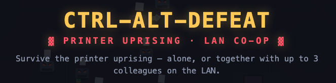

# CTRL-ALT-DEFEAT — Printer Uprising (LAN co-op)

A small survivor-style browser game for lunch breaks: you are an IT admin, the office printers have
risen up, and your weapons fire on their own while you dodge. Play solo or with up to 3 colleagues
on the same network. The whole game is one `index.html`; the server is a single zero-dependency
Node.js file.

## Quick start

**1. Just play solo (no install):** open `index.html` in a browser. Highscores and the helpdesk
need the server, everything else works offline.

**2. Full version on your machine** (multiplayer on your network, highscores, helpdesk) — needs Node.js 18+:

    node server.js            # http://localhost:8091
    node server.js 9000       # or pick a port

On macOS you can also double-click `start-local.command`, which starts the server and opens the browser.
Others on your network join via `http://<your-ip>:8091`.

**3. Docker (for a shared server in your LAN):**

    ./setup.sh                    # once: creates data/, secrets/admin_password and .env
    docker compose up -d --build  # build + start on port 8091
    docker compose logs -f        # logs
    docker compose down           # stop

Highscores and tickets live in `./data` (bind mount, survives rebuilds). To update, pull the new
version and run `docker compose up -d --build` again. Options in `.env`: `PORT`, `BIND_IP`
(listen on one LAN address only), `APP_UID`/`APP_GID` (owner of `./data`).

## Play
1. **Host:** open `http://<SERVER_IP>:8091`, enter a name, click **HOST A NEW GAME**.
   A lobby with a big **room code** opens — share the code or click **copy invite link**
   (`http://<SERVER_IP>:8091/?join=CODE` pre-fills the code).
2. **Everyone else:** open the same URL (or the invite link), enter a name + the code under **JOIN A GAME**.
3. **Lobby:** everyone picks a **class** (can be changed until the start) and clicks **I'M READY**.
   The host sees name, class and ready state of every admin. Once all are ready the start button
   turns green — the host presses **START SHIFT** (or "START ANYWAY" if someone forgot to ready up).
4. **Late joiners** get a short "shift already running" screen, pick a class and jump in next to the host.

Controls: **WASD** / arrow keys to move, weapons fire automatically, **P** pauses (host only).
The host tab runs the authoritative simulation — keep it open. Max 4 admins per room.
If the host closes the tab, everyone gets a clean "HOST LOGGED OFF" screen.
The same guide is shown in-game on the start screen, and the **📖 FIELD MANUAL** explains every
printer, weapon, patch and pickup.

## Highscores & anti-cheat
Top 20, separately for **solo** and **multiplayer**, ranked by **points**: every destroyed printer
scores its value (USB 1, Inkjet 2, Router 3, Fax 4, Laserjet 6, Golem 50, Ink Blob 1,
Main Printer 1000 — `pts` in `EDEF`, `PTS` in `server.js`) plus 2 points per second survived.
Each entry also stores the final loadout (weapons + patches with levels) of every admin.
Older seasons stay viewable via the season selector (`archive` in `data/highscores.json`).

Scores are **recorded by the server only**. Every run (solo too) streams 20 Hz snapshots through
the server, which counts the points itself (a printer that vanishes from the snapshots was
destroyed; one that comes back is flagged) and checks the run against the game rules: max HP per
class, HP <= max HP, every hit against the strongest possible weapon hit, movement speed, game
clock vs. real time, kills vs. printers ever spawned, boss timing, level vs. available XP, patch
levels. Any violation -> "INTEGRITY CHECK FAILED", nothing is stored, the reason is shown to
everyone and logged (`INTEGRITY FAIL ...`). This stops DevTools number tweaking; someone forging
whole snapshots by script can still get through. The limits live in `server.js` (`CLS`, `WDMG`, ...)
and must be updated when balancing changes.

## Co-op XP & balancing
- **Shared team XP:** one XP bar for the whole team; each extra admin adds +55 % XP per level
  (`TEAM_XP_PER_PLAYER`). On a team level-up every admin picks a card at the same time; the shift
  resumes when all are done. Late joiners start at the team level and pick catch-up cards while the
  others keep playing (they are protected meanwhile).
- Classes: Sysadmin 135 speed / +20 % damage, Helpdesk 172 speed / 85 HP, DevOps 125 speed /
  10 % less damage taken / 0.9 HP/s regen. Every level adds +2 % damage; printer HP doubles every 110 s.
- Coffee: 3 % drop, heals 25 % max HP, +20 % speed for 5 s. Revive: 80 px, 2 s, reviver takes half damage.
- Balance is measured, not guessed: `npm run lab` (weapon DPS / passive effects) and
  `npm run lab:survival -- [file] [seeds]` (bot plays every class, survival time per class).

## Helpdesk tickets
**🎫 HELPDESK** in the menu: everybody can open tickets (bug / feature / other, priority) and comment.
Admins change status (NEW / IN PROGRESS / RESOLVED / WON'T FIX) and delete tickets.
Stored in `data/tickets.json`. Rate limits: 1 ticket / 15 s, 1 comment / 5 s per IP.

## Admin
The admin password comes from `ADMIN_PASSWORD` or the file named in `ADMIN_PASSWORD_FILE`
(Docker: `secrets/admin_password`, created by `setup.sh`). Without one, admin functions are disabled.
Log in via **🔑 admin** in the helpdesk or highscore screen; admins can also delete highscores.
5 wrong passwords -> 5 min lockout per IP. The game uses plain HTTP, so treat it as a game
password, not a real one. Change it: edit the file, then `docker compose restart`.

## Security notes
Meant for a trusted LAN: allow inbound TCP 8091 on the server from your LAN only and never
port-forward it to the internet. The server only serves `index.html` and its JSON API.

## Development & tests
The game itself has **no dependencies**. The tests drive real headless Chrome instances via
`playwright-core` (dev only) against a local server on ports 182xx.

    npm install
    npx playwright install chromium        # or: export CHROME=/path/to/chrome
    npm test                               # api, ui, manual, balance, score, anti-cheat, endless boss
    npm run test:edge                      # maxed builds + real 150 s boss run  (~3 min)
    npm run lab                            # power-up lab: DPS per weapon level/passive, passive effects
    npm run lab:survival                   # survival lab: bot plays each class (fixed seeds)

Run them after every change to `index.html` / `server.js`, especially balancing changes:
the anti-cheat limits in `server.js` (`CLS`, `WDMG`, ...) must match the game constants.

## Files
- `index.html` — the whole game (host + client logic, lobby, highscores, helpdesk UI) in one page
- `server.js` — static server, WebSocket room relay, anti-cheat witness, highscore/ticket/admin API
- `Dockerfile`, `compose.yaml`, `.dockerignore`, `setup.sh` — hardened container setup
- `start-local.command` — start the server locally and open the browser (macOS / Linux)
- `tests/` — headless-browser and API test suites, balance labs (dev only)

## License
[MIT](LICENSE) © 2026 ITsRauch
